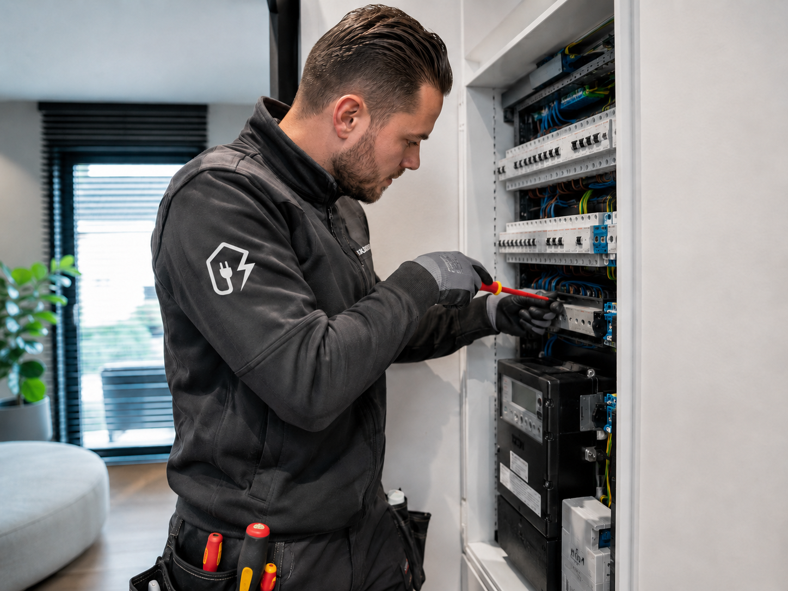

# AlleKlussers

Website voor AlleKlussers, een klus- en elektrabedrijf in de regio Rotterdam.

**Live:** [alleklussers.vercel.app](https://alleklussers.vercel.app)



## Wat de site doet

- Presenteert zeven diensten: elektra, badkamer, keuken, schilderwerk, vloeren, mutatieonderhoud en complete renovatie
- Projectpagina's met fotogalerijen (badkamer, eettafelverlichting, thuisgym)
- Werkwijze in vier stappen, klantreviews en partners (Marktplaats, Klussendirect)
- Offerte aanvragen via e-mail of WhatsApp met zwevende contactknoppen
- Zes talen: Nederlands, Engels, Turks, Arabisch (rechts-naar-links), Pools en Duits
- Volledig responsive, met aparte stijlen voor mobiel en tablet
- SEO: meta-tags en gestructureerde data (JSON-LD) voor lokale vindbaarheid

## Techniek

| Onderdeel | Gebruikt |
| --- | --- |
| Opmaak | HTML5, CSS3, Tailwind CSS (CDN) |
| Interactie | Vanilla JavaScript (navigatie, taalwissel, contactwidget) |
| Hosting | Vercel |

Geen build-stap nodig: de site bestaat uit statische bestanden.

## Projectstructuur

```
index.html          De hele site (één pagina met secties)
script.js           Navigatie, taalwissel, contactknoppen; laadt de extra stylesheets
styles.css          Basisstijlen
*-overrides.css     Aanpassingen per sectie (hero, over ons, diensten, mobiel)
*-polish.css        Fijnafstemming per sectie en voor tablet
badkamer/ eettafel/ fitness/   Projectfoto's
partners/           Partnerlogo's
```

## Lokaal draaien

```bash
git clone https://github.com/samigulec/alleklussers.git
cd alleklussers
npx serve .
```

Open daarna http://localhost:3000.

## Werkwijze

Gebouwd door Sami Güleç, AI-first ontwikkeld samen met [Claude](https://claude.ai).
