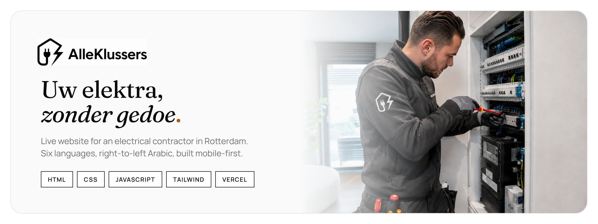
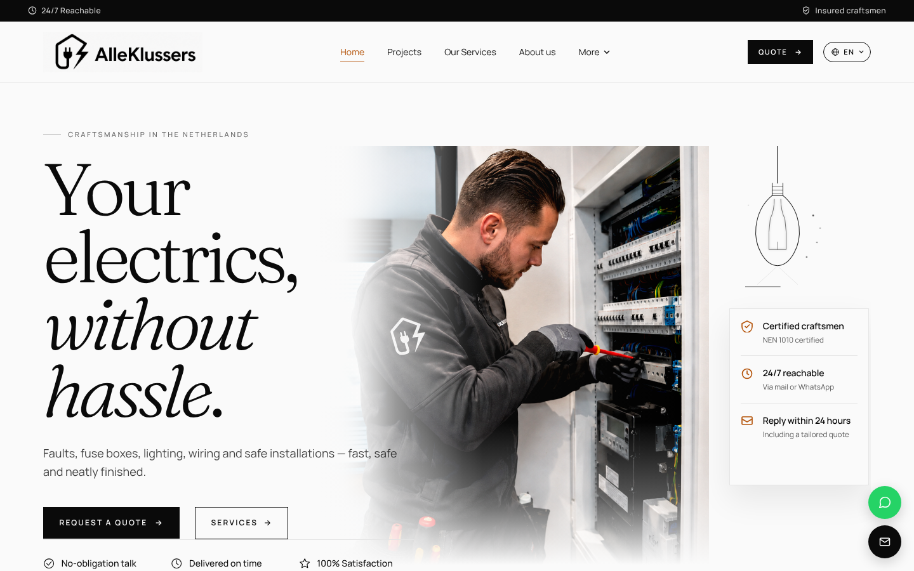
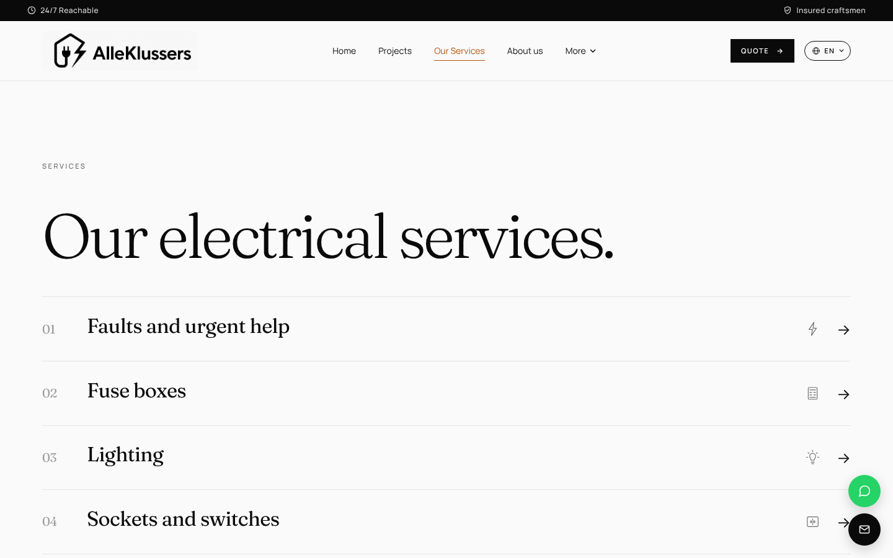
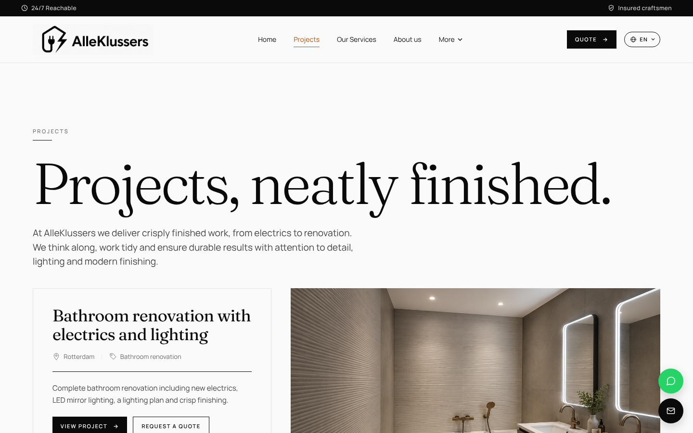
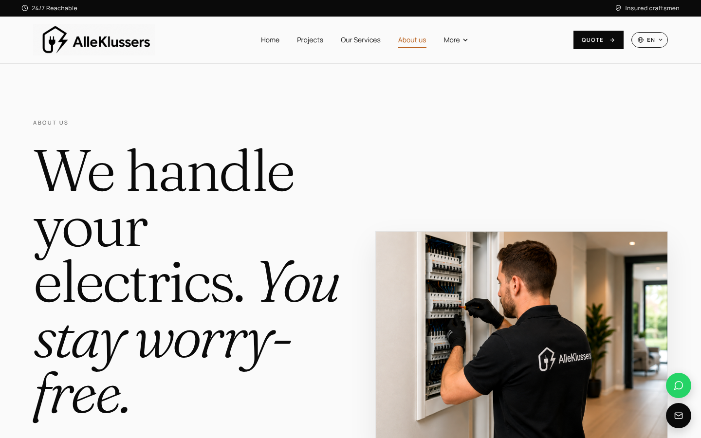
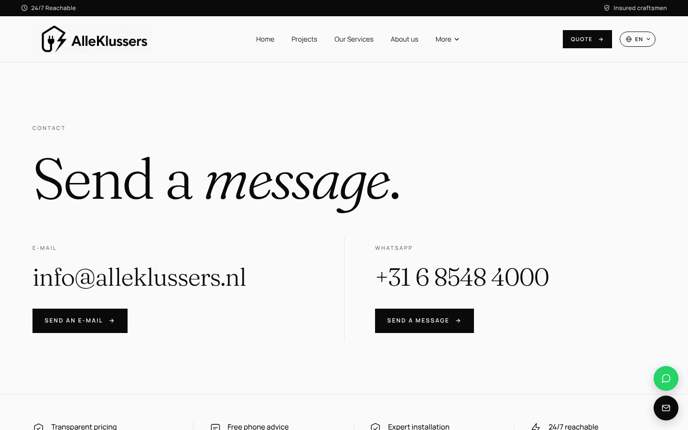
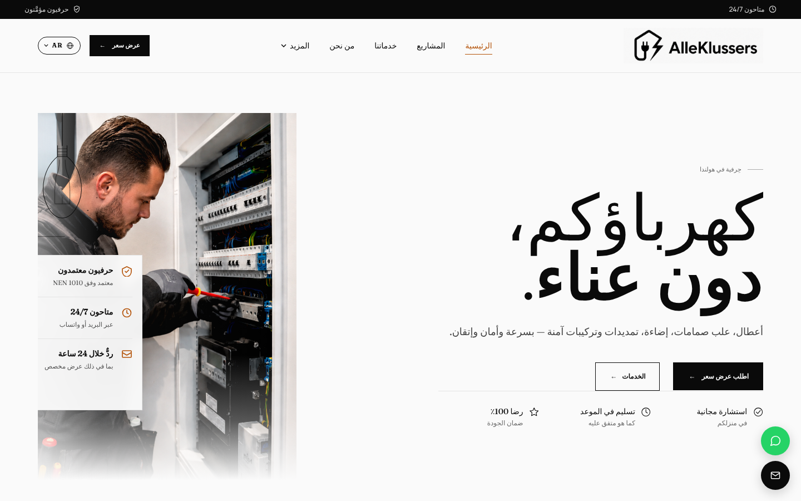
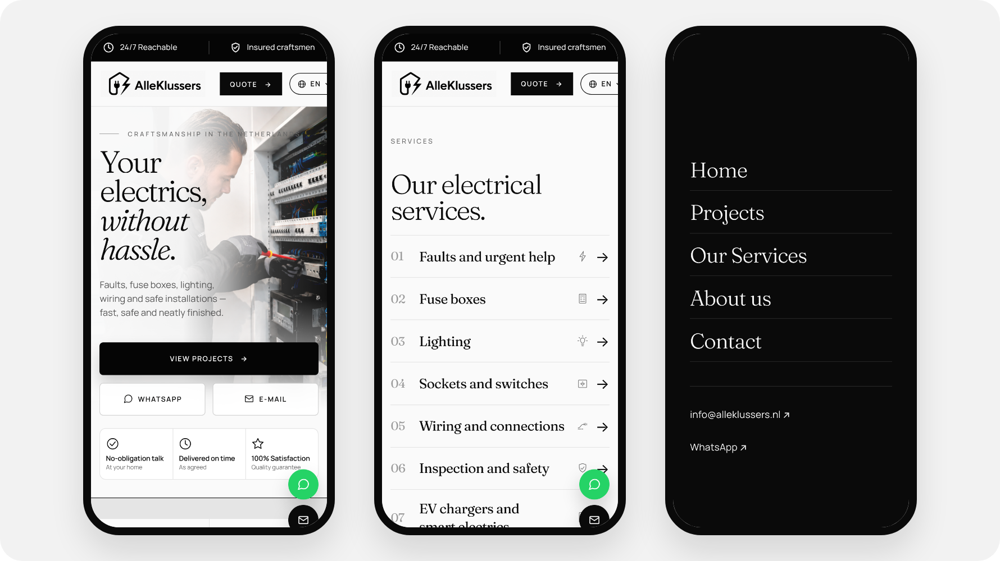

<p align="center">
  
</p>

<p align="center">
  <b>A live website for an electrical contractor in Rotterdam.</b><br>
  Six languages, right-to-left Arabic, designed for the phone first.
</p>

<p align="center">
  
  
  
  
  
  
</p>

<p align="center">
  <a href="https://alleklussers.nl"><b>alleklussers.nl</b></a> ·
  <a href="#-what-it-does">Features</a> ·
  <a href="#-screens">Screens</a> ·
  <a href="#-under-the-hood">Under the hood</a> ·
  <a href="#-run-it-locally">Run locally</a> ·
  <a href="#-nederlands">Nederlands</a>
</p>

<p align="center">
  
</p>

---

## ✨ What it does

AlleKlussers is a team of certified electricians in the Rotterdam area. The site has one job: make it easy for a
homeowner or business to see what they do, trust them, and ask for a quote in one tap.

<table>
<tr>
<td width="50%" valign="top">

### ⚡ Services
- Seven services, each with its own icon: faults and urgent help, fuse boxes, lighting, sockets and switches,
  wiring, inspection and safety, EV chargers and smart electrics
- Trust points up front: NEN 1010 certified, insured, reply within 24 hours

</td>
<td width="50%" valign="top">

### 🖼 Projects
- Real jobs with photo galleries: a bathroom with LED mirror lighting, dining-table lighting, a home gym
- Swipeable carousel with arrows and dots
- Full-screen lightbox, navigable with arrow keys, closes with Escape

</td>
</tr>
<tr>
<td valign="top">

### 💬 Getting in touch
- "Request a quote" buttons throughout the page
- Floating WhatsApp and e-mail buttons that stay in reach on every screen
- Direct links to the company's Marktplaats and Klussendirect listings

</td>
<td valign="top">

### 🌍 Six languages
- Dutch, English, Turkish, Arabic, Polish and German
- Arabic switches the whole layout to right-to-left
- Picks the visitor's browser language and remembers their choice

</td>
</tr>
</table>

---

## 📸 Screens

<table>
<tr>
<td width="50%"><br><sub><b>Services</b>: seven numbered services with icons</sub></td>
<td width="50%"><br><sub><b>Projects</b>: real jobs with photo galleries</sub></td>
</tr>
<tr>
<td><br><sub><b>About us</b>: who they are and how they work</sub></td>
<td><br><sub><b>Contact</b>: e-mail or WhatsApp, no forms to fill in</sub></td>
</tr>
<tr>
<td colspan="2"><br><sub><b>Arabic</b>: the whole layout mirrors to right-to-left</sub></td>
</tr>
</table>

<p align="center">
  <br>
  <sub><b>On the phone</b>: big tap targets, a full-screen menu and contact buttons always in reach</sub>
</p>

---

## 🛠 Under the hood

| | |
|---|---|
| **Markup** | One `index.html` with five views (home, projects, services, about, contact), switched with URL hashes so there are no page reloads |
| **Styling** | Tailwind CSS via CDN plus hand-written CSS; Fraunces for headings, Manrope for body text |
| **Behaviour** | Vanilla JavaScript: navigation, language switch, mobile menu, project carousel and lightbox |
| **i18n** | Every text exists in six languages in the HTML; `data-lang` on `<html>` decides which one shows, `dir="rtl"` for Arabic |
| **SEO** | Meta tags, Open Graph and JSON-LD structured data (`Electrician`, `Organization`) for local search |
| **Hosting** | Vercel, deployed on every push |

No build step and no dependencies: the site is plain static files.

### Project layout

```
index.html              The whole site: five views, all six languages
script.js               Navigation, language switch, menu, carousel, lightbox
styles.css              Base styles
*-overrides.css         Section styles (hero, about, services, mobile)
*-polish.css            Fine-tuning per section and for tablets
badkamer/ eettafel/ fitness/   Project photos
docs/                   README images
```

---

## 🚀 Run it locally

```bash
git clone https://github.com/samigulec/alleklussers.git
cd alleklussers
npx serve .
```

Then open http://localhost:3000.

---

## 🤖 How it was built

Designed and built by **Sami Güleç** together with [Claude](https://claude.ai) as an AI pair programmer:
I decide what the site needs and check every change, Claude helps write and refine the code.

---

## 🇳🇱 Nederlands

**AlleKlussers** is de website van een team gecertificeerde elektriciens in de regio Rotterdam, live op
[alleklussers.nl](https://alleklussers.nl).

- Zeven diensten, van storingen en groepenkasten tot laadpalen en slimme elektra
- Projecten met fotogalerijen, carrousel en lightbox
- Offerte aanvragen via WhatsApp of e-mail met zwevende contactknoppen
- Zes talen (NL, EN, TR, AR, PL, DE), Arabisch van rechts naar links
- Gebouwd met HTML, CSS, JavaScript en Tailwind, gehost op Vercel

Gemaakt door Sami Güleç, AI-first ontwikkeld samen met Claude.
